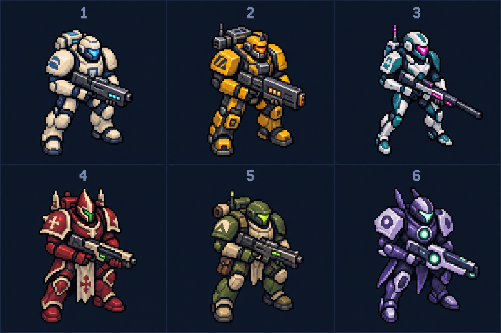

# Оформление игры

## HELIOS H11 — брутальный стиль и единая пиксельная сетка

[Поселение](helios-h11-game.png), [детализированные здания](helios-h11-buildings.png), [юниты](helios-h11-units.png). Нативная сетка всех новых объектов едина; построения и оборудование детализированы без увеличения занимаемых клеток. H10 сохранена меткой `helios-h10-before-brutal-refresh`; архивное H9-оформление доступно через настройки. Сцена поселения использует тестовые запасы.

## HELIOS H10 — новое оформление с возвратом к H9

[Поселение H10](helios-h10-game.png), [та же сцена с прежними спрайтами H9](helios-h9-comparison.png), [галерея H10](helios-h10-gallery.png). Сцена снята с тестовыми запасами. В меню и галерее можно переключить оформление без сброса партии. Полный исходный проект сохранён в метке `helios-h9-before-visual-refresh` и ветке `backup/helios-h9-before-visual-refresh`.

## Спрайт-лист рабочего — концепт

[Скачать PNG](worker-animation-concept.png). Жёлтый рабочий: шесть строк по восемь кадров — ожидание, ходьба, перенос груза, строительство/ремонт, сбор ресурсов и гибель. Сгенерирован по референсу пользователя; перед применением нужно выровнять кадры под игровую сетку 32×32. Изображение сохранено для обсуждения и **не подключено к игре**. Текущая игровая версия — HELIOS H11; этот концепт остаётся отдельным PNG, игровой рабочий рисуется кодом.

## Скриншоты HELIOS H4 — архив

Планетарная кампания с отдельными поселениями и автоматическими боями. Военный пиксельный стиль H3 сохранён; дроны заменены жителями, добавлены поле, завод и торговая гильдия.

- [Поселение и производство](helios-h4-game.png)
- [Космическая карта](helios-h4-space.png)
- [Армия и отправка отрядов](helios-h4-army.png)
- [Автоматический бой](helios-h4-battle.png)
- [Интерактивная галерея спрайтов](../../art-preview.html)

Скриншоты сняты с работающего интерфейса во время проверки с увеличенными тестовыми запасами для быстрого прохождения сценария. Боевые защитники в сценарии добавлены для проверки сражения, а не как демонстрация балансной партии.

### Визуальная версия H3 — архив

[Направление оформления](STYLE.md), [лист спрайтов](helios-h3-preview.png), [поле боя](helios-h3-game.png), [меню](helios-h3-menu.png).

## Ранние варианты дизайна десантника

Лист для выбора художественного направления. Это концепты, а не готовый игровой атлас: выбранный образ потребуется адаптировать под размер и ракурс RTS.

1. Классический десантник: светлая массивная броня, голубая подсветка.
2. Индустриальный: жёлтая тяжёлая броня, механический ранец.
3. Киберпанк: лёгкий силуэт, белая броня, розовый неон.
4. Космическая готика: багровая броня и острые наплечники.
5. Планетарный рейнджер: практичная экипировка, армейская палитра.
6. Воин пустоты: фиолетовая броня и зелёное энергетическое ядро.
